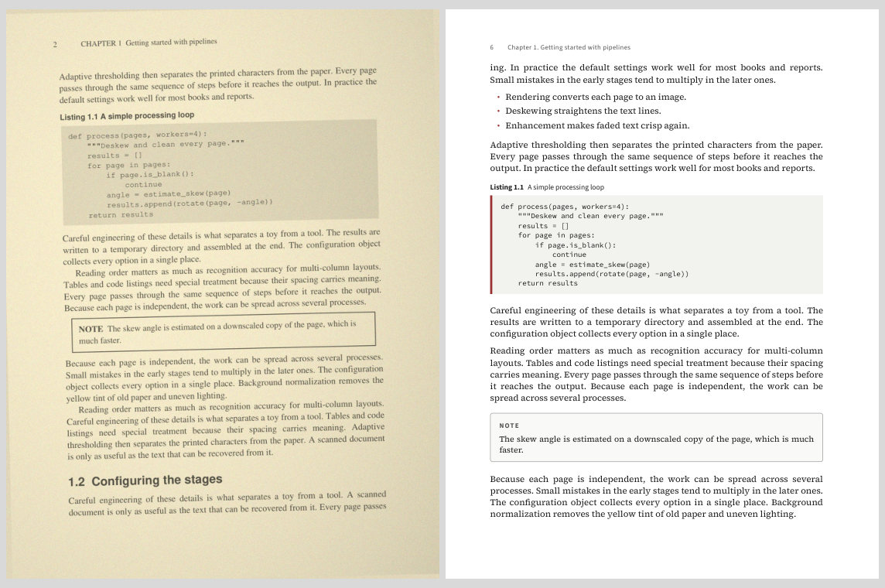

# PDF-Align

Turn large, badly scanned PDFs (crooked, sideways, yellowed, faded, noisy) into clean, straight,
**searchable** PDFs, or rebuild a scanned technical book as a **professionally typeset book**.

| | |
|---|---|
| **Mode A · Visual deskew & enhance** | Keeps each page's original look. It straightens the page, whitens the paper, sharpens faded text and keeps photos in colour, then lays an invisible OCR text layer on top (select, search, copy). |
| **Mode B · Typeset as a book** | Reconstructs the book's structure (chapters, numbered sections, paragraphs, code listings, NOTE/TIP callouts, lists, figures and tables with captions) and typesets it like a classic computer book. You get a 7 × 9.19 in trim, mirrored margins, running heads, chapter openers on right-hand pages, a generated table of contents, PDF bookmarks, hyphenated justified text, and code in a monospace font with its indentation preserved. |



Built for books with hundreds of pages. Pages are streamed through a process pool, so memory stays flat no matter how long the document is.

---

## Quick start

You need Python 3.10+ and Tesseract. **On a Mac, follow [macOS setup](#macos-setup-apple-silicon--intel) below**.
For Linux and Windows, see [Installation](#installation). Then:

```bash
python3 -m venv .venv && source .venv/bin/activate
pip install -r requirements.txt

# web UI -> http://localhost:8501
streamlit run app.py

# or the command line
python -m pdf_align.cli scan.pdf clean.pdf --mode A
python -m pdf_align.cli scan.pdf book.pdf  --mode B --page-size A4
```

Or with Docker:

```bash
docker build -t pdf-align . && docker run -p 8501:8501 pdf-align
```

## macOS setup (Apple Silicon & Intel)

This works on macOS 12 or later, on both Apple Silicon (M1–M4) and Intel Macs. All Python dependencies ship
native arm64 wheels, so there's nothing to compile. Run each block in **Terminal** in order.

**1. Install Homebrew** (skip this if `brew --version` already works):

```bash
/bin/bash -c "$(curl -fsSL https://raw.githubusercontent.com/Homebrew/install/HEAD/install.sh)"
```

On Apple Silicon, add Homebrew to your shell so `brew`, `python3.12` and `tesseract` are found in every new
terminal. Intel Macs use `/usr/local` and need no extra step.

```bash
echo 'eval "$(/opt/homebrew/bin/brew shellenv)"' >> ~/.zprofile
```

```bash
eval "$(/opt/homebrew/bin/brew shellenv)"
```

**2. Install Python 3.12, Tesseract and Pango.**
* The `python3` that ships with macOS (or the Xcode tools) is often 3.9, which is too old for this app.
* Homebrew's `tesseract` already includes English and the `osd` orientation model.
* **Pango** is the text-layout library used by the Mode B book typesetter (WeasyPrint).

```bash
brew install python@3.12 tesseract pango
```

Optional: OCR languages other than English, e.g. `--lang eng+deu`:

```bash
brew install tesseract-lang
```

Optional: **more accurate OCR models** (`tessdata_best`). They are slower, but make noticeably fewer
mistakes on poor scans. Download them into a folder of your own and point the app at it:

```bash
mkdir -p ~/tessdata_best && cp "$(brew --prefix)/share/tessdata/osd.traineddata" ~/tessdata_best/
```

```bash
curl -L -o ~/tessdata_best/eng.traineddata https://github.com/tesseract-ocr/tessdata_best/raw/main/eng.traineddata
```

Then add `--tessdata-dir ~/tessdata_best` on the command line.

The book fonts (Source Serif 4, Source Sans 3 and Source Code Pro, under the SIL Open Font License) ship
inside the app, so there's nothing to install for them.

**3. Create a virtual environment and install the app.** Run this inside the cloned `pdf-align` folder:

```bash
python3.12 -m venv .venv
```

```bash
source .venv/bin/activate
```

```bash
pip install --upgrade pip && pip install -r requirements.txt
```

**4. Check the installation.** `tesseract --list-langs` must list `eng` and `osd`:

```bash
tesseract --version && tesseract --list-langs
```

```bash
python -c "import pymupdf, cv2, pytesseract, reportlab, streamlit; print('all good', pytesseract.get_tesseract_version())"
```

**5. Run it.** Streamlit opens your browser at http://localhost:8501. Stop it with `Ctrl+C`.

```bash
streamlit run app.py
```

Next time, only activate the environment and run:

```bash
cd pdf-align && source .venv/bin/activate && streamlit run app.py
```

### macOS troubleshooting

| Symptom | Fix |
|---|---|
| `TesseractNotFoundError` or "Tesseract not found" in the sidebar | Homebrew isn't on the `PATH` of the terminal that started Streamlit. Run `eval "$(/opt/homebrew/bin/brew shellenv)"` (step 1) and restart Streamlit. `which tesseract` should print `/opt/homebrew/bin/tesseract` (Apple Silicon) or `/usr/local/bin/tesseract` (Intel). |
| `python3 --version` shows 3.9 / `ERROR: Package requires Python >=3.10` | Use `python3.12` explicitly when creating the venv (step 3). Delete an old `.venv` first with `rm -rf .venv`. |
| `zsh: command not found: brew` | Finish step 1, then open a new Terminal window. |
| `xcrun: error: invalid active developer path` | Install the command-line tools with `xcode-select --install`, then retry. |
| Mac gets hot or slow, or "Your system has run out of application memory" | Each worker uses ~500 MB at 300 DPI. On 8 GB Macs, set **Worker processes** to 2–3 in the sidebar (or `--workers 2`), or use 200 DPI. |
| Very first run is slow | macOS checks the freshly installed native libraries once; later runs are fast. |
| Browser doesn't open | Open http://localhost:8501 manually. |
| `OSError: cannot load library 'libgobject-2.0-0'` / "WeasyPrint unavailable … used the basic ReportLab layout" | Pango is missing or not found. Run `brew install pango`. If it's already installed on Apple Silicon, run `export DYLD_FALLBACK_LIBRARY_PATH=/opt/homebrew/lib` in the same terminal before `streamlit run app.py` (add it to `~/.zprofile` to make it permanent). |

**Docker alternative:** with [Docker Desktop for Mac](https://www.docker.com/products/docker-desktop/)
installed, `docker build -t pdf-align . && docker run -p 8501:8501 pdf-align` works on both Apple Silicon
and Intel. The base image is multi-arch. Native installs are faster than Docker on a Mac, though.

## The web UI


* Drag-and-drop upload (up to 2 GB; see `.streamlit/config.toml`).
* An automatic **before / after preview** of the first two pages. The "after" image is rendered from a real
  output PDF in the selected mode, so what you see is what you get.
* A **live progress bar** ("Page X of Y", with ETA) plus a live log of the skew/rotation fixed on each page.
* A summary of pages, mean skew corrected, blank pages and errors, a per-page details table, and a **download button**.
* Settings: mode, page size, DPI, enhancement strength, B/W vs. grayscale text, OCR language, worker count,
  pages in flight, blank-page removal and per-page timeout.

## Project structure

```
pdf-align/
├── app.py                  # Streamlit UI
├── pdf_align/
│   ├── config.py           # PipelineConfig: every tuning knob, picklable
│   ├── models.py           # Word / Line / Block / PageLayout / PageResult (JSON round-trip)
│   ├── deskew.py           # CV: render, blank check, orientation, skew, rotate, enhance
│   ├── layout_engine.py    # OCR engines, tables, figures, XY-cut reading order, block types
│   ├── pdf_builder.py      # Mode A (PyMuPDF) builder, Mode B BookBuilder (+ ReportLab fallback)
│   ├── structure.py        # whole-book structure: chapters, sections, paragraphs, lists, captions…
│   ├── textfix.py          # OCR clean-up: de-hyphenation, ligatures, conservative word repair
│   ├── typeset/            # Mode B typesetter: book.html.j2 + book.css (paged media) + fonts/ (OFL)
│   ├── pipeline.py         # streaming orchestration, process pool, recovery, cleanup
│   └── cli.py              # command-line front-end
├── tools/build_fonts.py    # regenerates the bundled static font files
├── tests/
│   ├── synth.py            # synthetic "bad scan" generator (skew, fading, noise, rotation)
│   ├── techbook.py         # synthetic scanned *technical book* with ground truth
│   ├── test_book.py        # Mode B structure + typesetting tests
│   ├── conftest.py
│   ├── test_deskew.py
│   ├── test_layout.py
│   └── test_pipeline.py
├── requirements.txt
├── requirements-surya.txt  # optional transformer OCR
├── packages.txt            # apt packages (Streamlit Community Cloud picks this up)
├── Dockerfile
└── .streamlit/config.toml
```

## How it works

### 1. Computer-vision pipeline (`deskew.py`)

Each worker process runs these steps for one page:

1. **Render** one page at 300 DPI with PyMuPDF. The worker opens the PDF itself, so only a file path and a
   page number cross process boundaries. Oversized pages (posters) are rendered at a capped resolution.
2. **Blank detection.** After background normalisation, a page with less than 0.15 % ink inside its margins
   counts as blank. Blank pages are kept or dropped, depending on the setting.
3. **Orientation (0/90/180/270).** Two questions, each answered by the tool best suited to it:
   * *Sideways or not?* This is decided geometrically. The pipeline compares how sharp the row and column
     projection profiles of glyph-sized components are, and the test tolerates skew.
   * *Up or down?* Tesseract OSD decides this, but only after the page has been turned upright (or upside-down),
     deskewed and stripped of ruling lines, which is when OSD is reliable. On grid-like pages (tables) both
     hypotheses go to OSD. A 180° flip needs real confidence, because a wrong flip is worse than none.
4. **Skew estimation**, in three stages:
   * a projection-profile sweep (Postl's sharpness criterion) over ±15° in 0.5° steps;
   * a Hough-transform cross-check on text lines smeared into bars;
   * a 0.05° refinement step.

   The estimator uses only *character-sized* connected components, so scanner-bed edges, page borders and
   table rules can't create a false peak at 0°. Points get sub-pixel jitter to avoid quantisation bias.
   If no dominant line direction exists (for example on a photo page), no rotation is applied.
   Measured accuracy on the synthetic test pages is ±0.05°.
5. **Rotation without cropping.** The rotation canvas is computed from the rotated corners, and new corners
   are filled with the paper colour. The canvas is then trimmed back to the original page size, centred on
   the content, but only where the trimmed area is empty paper. Text and borders are never cut.
6. **Enhancement:**
   * Background normalisation: divide by a morphological-closing estimate of the paper, which removes
     yellowing and uneven lighting.
   * Non-local-means denoising.
   * A levels and gamma lookup table that darkens faded strokes.
   * **Sauvola** local thresholding for crisp text, followed by speck removal and removal of
     scanner-border shadows.
   * Photos and diagrams are found by non-paper density and large line-art components, using *global*
     normalisation so a photo isn't mistaken for background. Ruled tables are excluded. These regions are
     not binarised; instead they get CLAHE, in colour when the source is colourful.
7. **Save compactly.** A pure text page is stored as a 1-bit PNG (tiny and razor sharp); a page with pictures
   is stored as JPEG.

### 2. Layout and reading order (`layout_engine.py`)

* **Before OCR:** ruling lines are detected by morphological opening with long kernels. Their positions
  define table grids, and the lines are then **erased from the OCR input**, because Tesseract misreads
  rules as characters.
* **OCR:** the default is Tesseract (`--oem 1 --psm 1`), which returns words plus block, paragraph and line
  structure. Surya is available as a pluggable alternative.
* **Blocks:** words are grouped into lines and then paragraphs. A line is split at gutter-sized gaps, and a
  block is split where the line spacing jumps.
* **Tables:**
  * *Ruled tables:* words are assigned to the detected row and column grid. If inner vertical rules are
    missing, columns are inferred from vertical whitespace.
  * *Borderless tables:* a block counts as a table when at least 3 of its lines split at large gaps into
    the same number of aligned cells.
* **Figures:** taken from the CV stage. Text inside a figure is removed from the flow but stays in the
  Mode A text layer.
* **Reading order:** a recursive **XY-cut**. Vertical cuts (column gutters) take priority. Horizontal cuts
  in a multi-column region are only allowed next to blocks that span the gutter, such as titles or wide
  figures. This prevents the classic XY-cut failure where columns get interleaved because their paragraph
  breaks happen to line up.
* **Classification:**
  * *header/footer:* the top or bottom 7 % band;
  * *heading:* line height at least 1.3× the median, or a short all-caps line (heading levels come from the
    size ratio);
  * *list:* lines that start with bullets or numbering;
  * *paragraph:* everything else.

### 3. Building the output (`pdf_builder.py`)

* **Mode A:**
  * The cleaned image goes onto the page: either at its own size, or fitted onto A4/Letter (landscape pages
    get a landscape page).
  * The invisible text layer is written with `render_mode=3`. Each word's font size is solved so its advance
    width matches the OCR box, which makes selection highlights line up with the visible glyphs. A Unicode
    font is used for non-Latin-1 words.
  * The document is **flushed to disk every 25 pages** (incremental save and reopen), so the builder's memory
    stays flat.
* **Mode B:** see the next section.

### 3b. Mode B: rebuilding and typesetting a book (`structure.py`, `typeset/`)

**Page analysis (in the workers):**
* **Code listings** are found from three cues:
  * how densely the text uses code symbols;
  * keywords and patterns like `def`, `->`, `name(args)`;
  * the tinted panel behind them.

  They are then re-OCR'd with the dictionaries switched off, so identifiers aren't "corrected" into English
  words. Each line is rebuilt on the **monospace character grid**, which brings back the exact indentation
  and spacing (Tesseract drops both).
* **Tinted panels** (code backgrounds, sidebars) are detected against a robust model of the paper's
  lighting. Text inside them is binarised for OCR, and the tint is painted back for Mode A.
* **Boxed frames** become callouts or sidebars.
* **Large bold titles** keep solid strokes (Sauvola thresholding would hollow them out).
* **Ruling lines** are only erased when they are both long and thin, so letter stems survive.

**Whole-book structure (parent process, `structure.py`):** statistics gathered from all pages drive these
decisions:
* **Running heads and folios** are dropped. The test uses their position, isolation and content (page
  numbers, "CHAPTER", section text), not just repetition.
* **Chapters** come from "CHAPTER n" labels and big title type. **Sections** come from numbering
  (`1.2`, `1.2.3`), with bold or size as supporting evidence.
* **Paragraphs** are rebuilt across Tesseract blocks, columns and pages:
  * a short last line or a first-line indent ends a paragraph;
  * text that runs on across a page break is joined.
* **Lists:** bullets are recognised even when OCR reads them as `e`/`«`/`o`. Numbered items must form a
  sequence, and continuation lines are recognised by their hanging indent.
* **Captions** attach to the right object: `Listing`/`Example` and `Table` captions look below
  themselves, `Figure` captions look above.
* **Callouts** come from NOTE/TIP/WARNING/CAUTION labels or a boxed frame.
* **Prose clean-up** (`textfix.py`):
  * de-hyphenation and ligature/quote normalisation;
  * fixes for confusable glyphs (`Smal!`→`Small`, `rnodern`→`modern`);
  * dictionary correction, but only for words Tesseract itself was unsure about. Code is never touched.

**Typesetting (`typeset/`):** WeasyPrint renders semantic HTML with a CSS paged-media stylesheet:
* **Pages:** 7 × 9.19 in trim (also 7.375 × 9.25 in, A4 or Letter) with mirrored inner and outer margins.
* **Running heads:** chapter on the verso, section on the recto. Chapter openers have none, and their folio
  sits at the foot.
* **Type:** Source Serif 4 body at 10/13.6 pt, justified, with Pyphen hyphenation, kerning and ligatures.
  Headings are in Source Sans 3.
* **Code:** Source Code Pro on a tinted panel with a rule, with the listing caption above.
* **Other elements:** labelled callout boxes, booktabs-style tables, and figures with captions.
* **Front matter:** a title page and a table of contents with dot leaders and real page numbers.
* **PDF bookmarks** for every chapter and section.

The whole look lives in `pdf_align/typeset/book.css`. Edit it to retheme the book. The intermediate HTML
can be written out with `--emit-html book.html` for inspection.

If WeasyPrint or Pango isn't installed, Mode B automatically falls back to a simpler ReportLab layout and
says so.

### 4. Streaming and parallelism (`pipeline.py`)

```
input.pdf ──► [ sliding window of N pages in flight ] ──► ProcessPoolExecutor (spawn)
                     │  each worker: render → orient → deskew → enhance → OCR → layout
                     ▼  writes page_00042.png + .json into a TemporaryDirectory
             re-order buffer (results arrive out of order)
                     ▼  strictly in page order
             builder.add_page()  ──►  Mode A deletes the page's files immediately
                     ▼
             builder.close() ──► output.pdf      (TemporaryDirectory removed, even on error)
```

* **No whole-document rasterisation.** At most `batch_size` pages are in flight, and a finished page is only
  a small file on disk.
* Workers use `spawn` (safe with MuPDF, OpenCV and Streamlit threads), and set `OMP_THREAD_LIMIT=1` so
  Tesseract and OpenCV don't oversubscribe the CPUs. Each worker is **recycled every 12 pages** to return
  fragmented heap memory to the OS (Python 3.11+).
* **Failure isolation:**
  * A page that throws keeps its original rendering and is reported as an error.
  * A page that can't be rendered becomes a placeholder page that says so.
  * A hung page hits the timeout; the pool is recycled and the other pages are re-queued.
  * A worker crash (segfault or OOM-kill) triggers `BrokenProcessPool` recovery: every page that was in
    flight is retried **in its own single-use process**, so the one bad page can't take down the job or the UI.
* **Input checks:**
  * Encrypted PDFs and non-PDF files are rejected with a clear message.
  * Files MuPDF had to repair are re-saved once, cleaned, before processing.

## Performance

These figures come from a synthetic 120-page bad scan (111 MB input). It has random ±8° skew, sideways pages,
tables, photos, two-column pages and 20 blank pages. The run used 4 CPU cores and 4 workers at 300 DPI.

| | Mode A | Mode B (book) |
|---|---|---|
| Time | ~1.0 s / page (≈2 min total) | ~1.2 s / page (≈2.4 min for a 120-page technical book, typesetting included) |
| Output size | 30 MB, searchable | typeset book with contents and bookmarks |
| Peak RAM (whole process tree) | ≈2.4 GB | ≈2 GB |
| Parent process RAM | flat ≈120 MB for the whole run | flat ≈85 MB, ≈300 MB during final typesetting |

Memory is roughly `workers × ~500 MB` (one 300-DPI page plus OCR) and **does not grow with page count**.
On a small machine, lower *Worker processes* or use 200 DPI.

## Installation

PyMuPDF renders PDFs itself, so **Poppler is not needed**. The system dependencies are:
* **Tesseract**, including its `osd` model, which is used for orientation detection;
* **Pango**, which the Mode B book typesetter (WeasyPrint) uses.

| OS | Command |
|---|---|
| Ubuntu / Debian | `sudo apt-get install tesseract-ocr tesseract-ocr-eng tesseract-ocr-osd libpango-1.0-0 libpangoft2-1.0-0 libharfbuzz-subset0` |
| Fedora | `sudo dnf install tesseract tesseract-langpack-eng tesseract-osd pango` |
| macOS | `brew install python@3.12 tesseract pango`: see the full [macOS setup](#macos-setup-apple-silicon--intel) above |
| Windows | Install the [UB Mannheim build](https://github.com/UB-Mannheim/tesseract/wiki), then add `C:\Program Files\Tesseract-OCR` to `PATH` |

To add more languages, install e.g. `tesseract-ocr-deu` (macOS: `brew install tesseract-lang`), then pass
`--lang eng+deu` or set the language in the UI sidebar.

**Optional: Surya OCR.** Install it with `pip install -r requirements-surya.txt`, then use `--engine surya`.
Surya is a transformer OCR that does better on very degraded scans and many scripts, but it is much heavier
(it pulls in PyTorch, and a GPU is recommended). It plugs in through the same `OCREngine` interface as
Tesseract. Blocks are rebuilt geometrically from Surya's line boxes.

## CLI reference

```
python -m pdf_align.cli INPUT OUTPUT [--mode A|B] [--dpi 300] [--page-size original|A4|Letter]
                        [--lang eng] [--engine tesseract|surya] [--workers N] [--batch-size 8]
                        [--strength 1.0] [--no-ocr] [--no-binarize] [--drop-blank] [--jpeg-quality 80]
                        [--trim 7x9.19in|7.375x9.25in|A4|Letter] [--title T] [--author A]
                        [--chapters-any-page] [--no-front-matter] [--no-spellfix]
                        [--tessdata-dir DIR] [--emit-html FILE]
```

For example, to typeset a scanned book:

```bash
python -m pdf_align.cli scan.pdf book.pdf --mode B --title "My Book" --author "Jane Doe"
```

Use it from Python:

```python
from pdf_align import PipelineConfig, run_pipeline

report = run_pipeline("scan.pdf", "book.pdf", PipelineConfig(mode="B", trim="7x9.19in", title="My Book"),
                      progress_cb=lambda done, total, msg, page: print(done, total, msg))
print(report.mean_abs_skew, [p.index for p in report.errors])
```

## Tests

```bash
pytest -q
```

The test suite generates its own degraded scans (`tests/synth.py`). It checks:

* skew accuracy (±0.3° over −12° to +9°);
* all four orientations on text, table and two-column pages;
* that rotation never crops;
* blank-page detection;
* paper whitening and photo preservation;
* two-column reading order;
* exact ruled-table reconstruction;
* figure crops and JSON round-trips;
* end-to-end output in both modes: searchability, page order, progress callbacks;
* **Mode B against a synthetic scanned technical book** (`tests/techbook.py`) with ground truth:
  * chapters and numbered sections exact;
  * paragraph count;
  * prose word error rate under 1 %;
  * running heads removed;
  * code listings with exact indentation;
  * captions attached to the right objects;
  * lists, the NOTE callout, tables and figures;
  * the typeset PDF's trim size, embedded fonts and bookmarks;
  * TOC page numbers, chapter openers on odd pages without running heads, and text inside the margins;
  * the ReportLab fallback;
* that temp directories are cleaned up;
* rejection of encrypted and non-PDF input.

## Limitations and tips

* Borderless tables are found heuristically. Complex merged-cell tables are reproduced best in Mode A.
* Mode B is only as good as the OCR. For very poor scans, use the `tessdata_best` models (see macOS setup),
  Surya, or a higher DPI.
* Inline styling (bold or italic words, inline `code` inside sentences) isn't recovered from the scan yet.
  Block-level structure is.
* Structure detection is tuned for typical technical-book layouts. Unusual designs (side notes, multi-column
  reference pages) may need threshold tuning in `structure.py`.
* Handwriting isn't recognised as text. In Mode A it is preserved visually.
* A 180° flip is only applied when OSD is confident. Text-free upside-down pages are left as they are.
