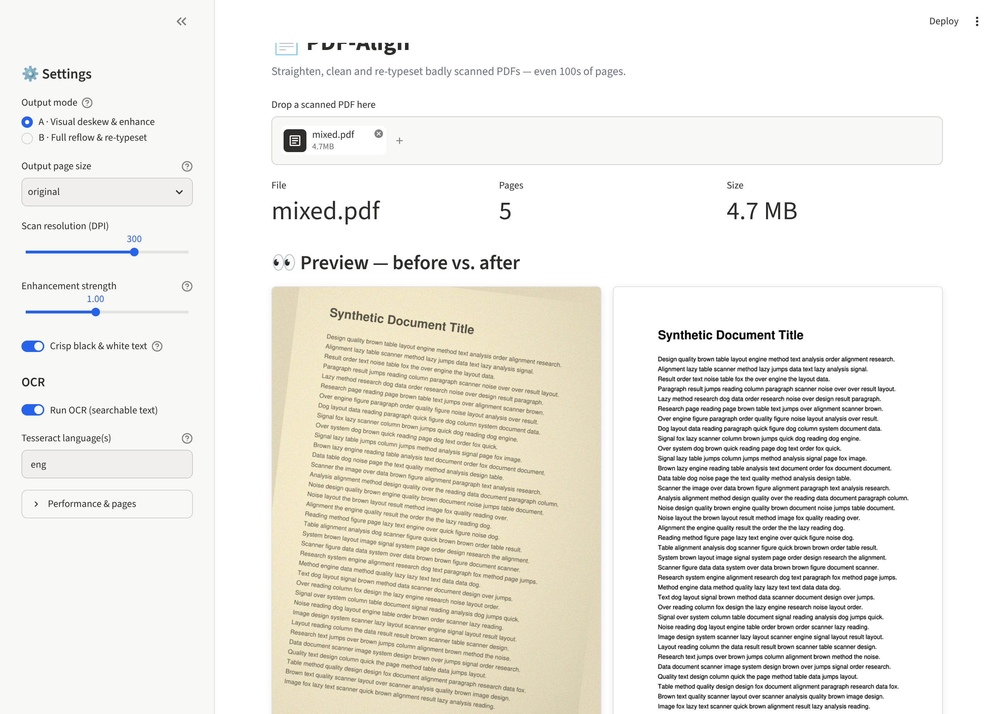

# PDF-Align

Turn large, badly scanned PDFs (crooked, sideways, yellowed, faded, noisy) into clean, straight,
**searchable** PDFs. You can also rebuild the scan as a freshly typeset document with modern typography.

| | |
|---|---|
| **Mode A · Visual deskew & enhance** | Keeps each page's original look. It straightens the page, whitens the paper, sharpens faded text and keeps photos in colour, then lays an invisible OCR text layer on top (select, search, copy). |
| **Mode B · Full reflow & re-typeset** | Rebuilds the document on A4/Letter, with clean fonts, justified paragraphs, real tables, cropped figures and correct multi-column reading order. Running headers and page numbers from the scan are removed. |

Built for books with hundreds of pages. Pages are streamed through a process pool, so memory stays flat no matter how long the document is.

---

## Quick start

```bash
# 1. system packages (see "Installation" for macOS / Windows)
sudo apt-get install -y tesseract-ocr tesseract-ocr-eng tesseract-ocr-osd fonts-dejavu-core

# 2. python packages (Python 3.10+)
python -m venv .venv && source .venv/bin/activate
pip install -r requirements.txt

# 3a. web UI
streamlit run app.py            # http://localhost:8501

# 3b. or command line
python -m pdf_align.cli scan.pdf clean.pdf --mode A
python -m pdf_align.cli scan.pdf book.pdf  --mode B --page-size A4
```

Or with Docker:

```bash
docker build -t pdf-align . && docker run -p 8501:8501 pdf-align
```

## The web UI



* Drag-and-drop upload (up to 2 GB; see `.streamlit/config.toml`).
* An automatic **before / after preview** of the first two pages. The "after" image is rendered from a real
  output PDF in the selected mode, so what you see is what you get.
* A **live progress bar** ("Page X of Y", with ETA) plus a live log of the skew/rotation fixed on each page.
* A summary of pages, mean skew corrected, blank pages and errors, a per-page details table, and a **download button**.
* Settings: mode, page size, DPI, enhancement strength, B/W vs. grayscale text, OCR language, worker count,
  pages in flight, blank-page removal and per-page timeout.

## Project structure

```
pdf-align/
├── app.py                  # Streamlit UI
├── pdf_align/
│   ├── config.py           # PipelineConfig: every tuning knob, picklable
│   ├── models.py           # Word / Line / Block / PageLayout / PageResult (JSON round-trip)
│   ├── deskew.py           # CV: render, blank check, orientation, skew, rotate, enhance
│   ├── layout_engine.py    # OCR engines, tables, figures, XY-cut reading order, block types
│   ├── pdf_builder.py      # Mode A (PyMuPDF) and Mode B (ReportLab) builders
│   ├── pipeline.py         # streaming orchestration, process pool, recovery, cleanup
│   └── cli.py              # command-line front-end
├── tests/
│   ├── synth.py            # synthetic "bad scan" generator (skew, fading, noise, rotation)
│   ├── conftest.py
│   ├── test_deskew.py
│   ├── test_layout.py
│   └── test_pipeline.py
├── requirements.txt
├── requirements-surya.txt  # optional transformer OCR
├── packages.txt            # apt packages (Streamlit Community Cloud picks this up)
├── Dockerfile
└── .streamlit/config.toml
```

## How it works

### 1. Computer-vision pipeline (`deskew.py`)

Each worker process runs these steps for one page:

1. **Render** one page at 300 DPI with PyMuPDF. The worker opens the PDF itself, so only a file path and a
   page number cross process boundaries. Oversized pages (posters) are rendered at a capped resolution.
2. **Blank detection.** After background normalisation, a page with less than 0.15 % ink inside its margins
   counts as blank. Blank pages are kept or dropped, depending on the setting.
3. **Orientation (0/90/180/270).** Two questions, each answered by the tool best suited to it:
   * *Sideways or not?* This is decided geometrically. The pipeline compares how sharp the row and column
     projection profiles of glyph-sized components are, and the test tolerates skew.
   * *Up or down?* Tesseract OSD decides this, but only after the page has been turned upright (or upside-down),
     deskewed and stripped of ruling lines, which is when OSD is reliable. On grid-like pages (tables) both
     hypotheses go to OSD. A 180° flip needs real confidence, because a wrong flip is worse than none.
4. **Skew estimation**, in three stages:
   * a projection-profile sweep (Postl's sharpness criterion) over ±15° in 0.5° steps;
   * a Hough-transform cross-check on text lines smeared into bars;
   * a 0.05° refinement step.

   The estimator uses only *character-sized* connected components, so scanner-bed edges, page borders and
   table rules can't create a false peak at 0°. Points get sub-pixel jitter to avoid quantisation bias.
   If no dominant line direction exists (for example on a photo page), no rotation is applied.
   Measured accuracy on the synthetic test pages is ±0.05°.
5. **Rotation without cropping.** The rotation canvas is computed from the rotated corners, and new corners
   are filled with the paper colour. The canvas is then trimmed back to the original page size, centred on
   the content, but only where the trimmed area is empty paper. Text and borders are never cut.
6. **Enhancement:**
   * Background normalisation: divide by a morphological-closing estimate of the paper, which removes
     yellowing and uneven lighting.
   * Non-local-means denoising.
   * A levels and gamma lookup table that darkens faded strokes.
   * **Sauvola** local thresholding for crisp text, followed by speck removal and removal of
     scanner-border shadows.
   * Photos and diagrams are found by non-paper density and large line-art components, using *global*
     normalisation so a photo isn't mistaken for background. Ruled tables are excluded. These regions are
     not binarised; instead they get CLAHE, in colour when the source is colourful.
7. **Save compactly.** A pure text page is stored as a 1-bit PNG (tiny and razor sharp); a page with pictures
   is stored as JPEG.

### 2. Layout and reading order (`layout_engine.py`)

* **Before OCR:** ruling lines are detected by morphological opening with long kernels. Their positions
  define table grids, and the lines are then **erased from the OCR input**, because Tesseract misreads
  rules as characters.
* **OCR:** the default is Tesseract (`--oem 1 --psm 1`), which returns words plus block, paragraph and line
  structure. Surya is available as a pluggable alternative.
* **Blocks:** words are grouped into lines and then paragraphs. A line is split at gutter-sized gaps, and a
  block is split where the line spacing jumps.
* **Tables:**
  * *Ruled tables:* words are assigned to the detected row and column grid. If inner vertical rules are
    missing, columns are inferred from vertical whitespace.
  * *Borderless tables:* a block counts as a table when at least 3 of its lines split at large gaps into
    the same number of aligned cells.
* **Figures:** taken from the CV stage. Text inside a figure is removed from the flow but stays in the
  Mode A text layer.
* **Reading order:** a recursive **XY-cut**. Vertical cuts (column gutters) take priority. Horizontal cuts
  in a multi-column region are only allowed next to blocks that span the gutter, such as titles or wide
  figures. This prevents the classic XY-cut failure where columns get interleaved because their paragraph
  breaks happen to line up.
* **Classification:**
  * *header/footer:* the top or bottom 7 % band;
  * *heading:* line height at least 1.3× the median, or a short all-caps line (heading levels come from the
    size ratio);
  * *list:* lines that start with bullets or numbering;
  * *paragraph:* everything else.

### 3. Building the output (`pdf_builder.py`)

* **Mode A:**
  * The cleaned image goes onto the page: either at its own size, or fitted onto A4/Letter (landscape pages
    get a landscape page).
  * The invisible text layer is written with `render_mode=3`. Each word's font size is solved so its advance
    width matches the OCR box, which makes selection highlights line up with the visible glyphs. A Unicode
    font is used for non-Latin-1 words.
  * The document is **flushed to disk every 25 pages** (incremental save and reopen), so the builder's memory
    stays flat.
* **Mode B:**
  * ReportLab Platypus renders the content with DejaVu Sans when available and Helvetica otherwise.
  * Text: justified body text with 1.45× leading, a heading hierarchy, and bulleted lists.
  * Tables: zebra-striped, with a header row that repeats across page breaks.
  * Figures: embedded as cropped images.
  * A cross-page pass removes **running headers, footers and page numbers** that repeat across pages,
    **joins paragraphs split by page breaks**, and **de-hyphenates** words like "infor-/mation".

### 4. Streaming and parallelism (`pipeline.py`)

```
input.pdf ──► [ sliding window of N pages in flight ] ──► ProcessPoolExecutor (spawn)
                     │  each worker: render → orient → deskew → enhance → OCR → layout
                     ▼  writes page_00042.png + .json into a TemporaryDirectory
             re-order buffer (results arrive out of order)
                     ▼  strictly in page order
             builder.add_page()  ──►  Mode A deletes the page's files immediately
                     ▼
             builder.close() ──► output.pdf      (TemporaryDirectory removed, even on error)
```

* **No whole-document rasterisation.** At most `batch_size` pages are in flight, and a finished page is only
  a small file on disk.
* Workers use `spawn` (safe with MuPDF, OpenCV and Streamlit threads), and set `OMP_THREAD_LIMIT=1` so
  Tesseract and OpenCV don't oversubscribe the CPUs. Each worker is **recycled every 12 pages** to return
  fragmented heap memory to the OS (Python 3.11+).
* **Failure isolation:**
  * A page that throws keeps its original rendering and is reported as an error.
  * A page that can't be rendered becomes a placeholder page that says so.
  * A hung page hits the timeout; the pool is recycled and the other pages are re-queued.
  * A worker crash (segfault or OOM-kill) triggers `BrokenProcessPool` recovery: every page that was in
    flight is retried **in its own single-use process**, so the one bad page can't take down the job or the UI.
* **Input checks:**
  * Encrypted PDFs and non-PDF files are rejected with a clear message.
  * Files MuPDF had to repair are re-saved once, cleaned, before processing.

## Performance

These figures come from a synthetic 120-page bad scan (111 MB input). It has random ±8° skew, sideways pages,
tables, photos, two-column pages and 20 blank pages. The run used 4 CPU cores and 4 workers at 300 DPI.

| | Mode A | Mode B |
|---|---|---|
| Time | ~1.0 s / page (≈2 min total) | ~1.0 s / page |
| Output size | 30 MB, searchable | 19 MB, 104 typeset pages |
| Peak RAM (whole process tree) | ≈2.4 GB | ≈2.1 GB |
| Parent process RAM | flat ≈120 MB for the whole run | flat |

Memory is roughly `workers × ~500 MB` (one 300-DPI page plus OCR) and **does not grow with page count**.
On a small machine, lower *Worker processes* or use 200 DPI.

## Installation

PyMuPDF renders PDFs itself, so **Poppler is not needed**. The only system dependency is **Tesseract**,
including its `osd` model, which is used for orientation detection.

| OS | Command |
|---|---|
| Ubuntu / Debian | `sudo apt-get install tesseract-ocr tesseract-ocr-eng tesseract-ocr-osd fonts-dejavu-core` |
| Fedora | `sudo dnf install tesseract tesseract-langpack-eng tesseract-osd dejavu-sans-fonts` |
| macOS (Homebrew) | `brew install tesseract` (includes `osd` and `eng`) |
| Windows | Install the [UB Mannheim build](https://github.com/UB-Mannheim/tesseract/wiki), then add `C:\Program Files\Tesseract-OCR` to `PATH` |

To add more languages, install e.g. `tesseract-ocr-deu` and pass `--lang eng+deu`, or set the language in
the UI sidebar.

**Optional: Surya OCR.** Install it with `pip install -r requirements-surya.txt`, then use `--engine surya`.
Surya is a transformer OCR that does better on very degraded scans and many scripts, but it is much heavier
(it pulls in PyTorch, and a GPU is recommended). It plugs in through the same `OCREngine` interface as
Tesseract. Blocks are rebuilt geometrically from Surya's line boxes.

## CLI reference

```
python -m pdf_align.cli INPUT OUTPUT [--mode A|B] [--dpi 300] [--page-size original|A4|Letter]
                        [--lang eng] [--engine tesseract|surya] [--workers N] [--batch-size 8]
                        [--strength 1.0] [--no-ocr] [--no-binarize] [--drop-blank] [--jpeg-quality 80]
```

Use it from Python:

```python
from pdf_align import PipelineConfig, run_pipeline

report = run_pipeline("scan.pdf", "clean.pdf", PipelineConfig(mode="B", page_size="Letter"),
                      progress_cb=lambda done, total, msg, page: print(done, total, msg))
print(report.mean_abs_skew, [p.index for p in report.errors])
```

## Tests

```bash
pytest -q
```

The test suite generates its own degraded scans (`tests/synth.py`). It checks:

* skew accuracy (±0.3° over −12° to +9°);
* all four orientations on text, table and two-column pages;
* that rotation never crops;
* blank-page detection;
* paper whitening and photo preservation;
* two-column reading order;
* exact ruled-table reconstruction;
* figure crops and JSON round-trips;
* end-to-end output in both modes: searchability, page order, progress callbacks;
* that temp directories are cleaned up;
* rejection of encrypted and non-PDF input.

## Limitations and tips

* Borderless tables are found heuristically. Complex merged-cell tables are reproduced best in Mode A.
* Mode B is only as good as the OCR. For very poor scans or non-Latin scripts, try Surya or a higher DPI.
* Handwriting isn't recognised as text. In Mode A it is preserved visually.
* A 180° flip is only applied when OSD is confident. Text-free upside-down pages are left as they are.
